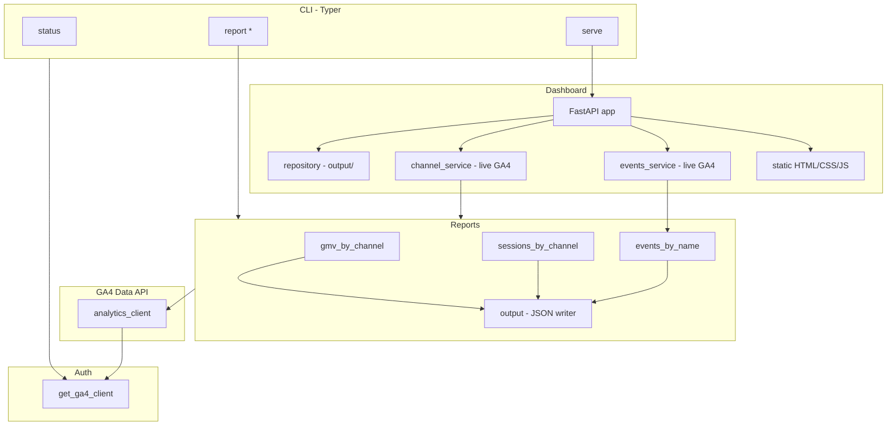

# KartmaX GA4 Connector

A Python tool for **KartmaX** that connects to **Google Analytics 4 (GA4)** via the [Google Analytics Data API](https://developers.google.com/analytics/devguides/reporting/data/v1), pulls marketing and commerce metrics, saves them as JSON exports, and serves a small local web UI to explore the data.

## What it does

| Capability | Description |
|------------|-------------|
| **Connectivity check** | Verifies service-account auth and property access with a minimal sessions report. |
| **Scheduled-style exports** | CLI commands fetch GA4 reports for a date range and write structured JSON under `output/`. |
| **Channel dashboard** | FastAPI app with a GA-inspired UI: GMV and sessions broken down by default channel group, with date filtering. |
| **Events explorer** | Live GA4 queries for events by name (summary + daily time series), with search/filter (default: events matching `purchase`). |

The dashboard can read from saved JSON files (repository layer) or query GA4 live (`channel_service` / `events_service`), depending on the API route and page.

## Technology stack

- **Python 3** (project uses 3.14 in local `__pycache__` artifacts)
- **google-analytics-data** — GA4 Data API client (`BetaAnalyticsDataClient`)
- **google-auth** — service account credentials
- **Typer** — CLI (`kartmax-ga4`)
- **FastAPI + Uvicorn** — local report viewer and JSON APIs
- **python-dotenv** — `.env` configuration
- **tzdata** — IANA timezones on Windows (aligned with GA4 property reporting timezone)
- **pytest** — unit tests for dates, report output, and dashboard repository

## Architecture



### Report types

| CLI command | GA4 metric(s) | Dimensions | Output stem | Notes |
|-------------|---------------|------------|-------------|--------|
| `report gmv-by-channel` | `grossPurchaseRevenue` | `date`, `sessionDefaultChannelGroup` | `gmv_by_channel_*.json` | Includes `currency` from API metadata when present |
| `report sessions-by-channel` | `sessions` | same | `sessions_by_channel_*.json` | |
| `report events-by-name` | sessions, eventCount, totalUsers, etc. | `eventName`; daily: `date` + `eventName` | `events_by_name_*.json` | Payload has `summary` and `daily` arrays (not only `data`) |

Export filenames use the report end date label, e.g. `gmv_by_channel_20261117.json`.

### JSON report shape (channel reports)

```json
{
  "property_id": "...",
  "report_type": "gmv_by_channel",
  "start_date": "YYYY-MM-DD",
  "end_date": "YYYY-MM-DD",
  "generated_at": "ISO-8601 UTC",
  "currency": "INR",
  "data": [
    { "date": "YYYY-MM-DD", "channel": "Organic Search", "gmv": "1234.56" }
  ]
}
```

## Project layout

```
kartmax-ga4-connector/
├── .env.example          # Template for credentials and property ID
├── output/               # Generated report JSON (gitignored except .gitkeep)
├── requirements.txt
├── src/
│   ├── main.py           # Typer entry: status, serve, report subcommands
│   ├── auth/
│   │   └── ga4_client.py # Service account client + connection test
│   ├── clients/
│   │   └── analytics_client.py  # runReport helpers and row parsing
│   ├── cli/
│   │   └── commands.py   # report gmv-by-channel, sessions-by-channel, events-by-name
│   ├── config/
│   │   ├── settings.py   # PROJECT_ROOT, OUTPUT_DIR, env getters
│   │   ├── dates.py      # Presets and GA4 date range resolution
│   │   └── logging_config.py
│   ├── reports/          # Fetch + validate + save per report type
│   └── dashboard/
│       ├── app.py        # FastAPI routes
│       ├── repository.py # List/load/aggregate JSON from output/
│       ├── channel_service.py
│       ├── events_service.py
│       └── static/       # index.html, events.html, theme, Chart.js UI
└── tests/
    ├── test_dates.py
    ├── test_report_output.py
    └── test_dashboard_repository.py
```

## Configuration

Copy `.env.example` to `.env` and set:

| Variable | Purpose |
|----------|---------|
| `GOOGLE_APPLICATION_CREDENTIALS` | Path to GA4 service account JSON (relative to project root, e.g. `.secrets/service-account.json`) |
| `GA4_PROPERTY_ID` | Numeric GA4 property ID |
| `GA4_REPORTING_TIMEZONE` | IANA timezone matching **Admin → Property settings → Reporting time zone** (example: `Asia/Kolkata`) |

Secrets and credentials are excluded from git via `.gitignore` (`.env`, `.secrets/`, `*service-account*.json`).

## CLI usage

Install dependencies:

```bash
pip install -r requirements.txt
```

Run from the project root (module path `src`):

```bash
python -m src.main status
python -m src.main report gmv-by-channel --preset yesterday
python -m src.main report sessions-by-channel --start-date 2026-11-01 --end-date 2026-11-17
python -m src.main report events-by-name --preset last-7-days
python -m src.main serve --host 127.0.0.1 --port 8080
```

**Date presets:** `yesterday`, `last-7-days`, `last-30-days`, `this-month` — computed in the property’s reporting timezone.

## Web dashboard

After `serve`:

| URL | Purpose |
|-----|---------|
| `http://127.0.0.1:8080/` | Channel overview (GMV and sessions by channel, date picker, charts) |
| `http://127.0.0.1:8080/events` | Events by name (live GA4, searchable) |
| `/api/dashboard` | Live channel aggregates for a date range |
| `/api/events` | Live events view (`search` query param) |
| `/api/range` | Min/max dates from latest JSON exports (for defaults) |
| `/api/reports`, `/api/reports/{filename}` | Browse raw exported JSON |

Static assets use a Google Analytics–style theme (`ga4-theme.css`, Material Symbols, Chart.js CDN).

## Data flow summary

1. **Export path:** CLI → GA4 API → validate rows → `output/*.json`.
2. **Dashboard (cached):** UI may use date range metadata from latest exports via `repository.get_available_range()` and aggregate rows from files.
3. **Dashboard (live):** `/api/dashboard` and `/api/events` call GA4 directly for the requested range without requiring a fresh export.

## Testing

```bash
pytest
```

Tests cover date resolution (presets, validation), report JSON writing/validation, and dashboard repository aggregation and path safety.

## Operational notes

- Empty GA4 result sets raise `ValueError` during validation (channel reports expect at least one row).
- Channel dimension values empty in GA4 are normalized to `(not set)`.
- GA4 API dates in `YYYYMMDD` form are normalized to `YYYY-MM-DD` in exports.
- `README.md` in the repo is currently empty; this document describes the project as implemented in source.

---

**Maintainer context:** Built for KartmaX analytics workflows—connecting GA4 property data to repeatable JSON exports and a local visualization layer without depending on the GA4 web UI alone.