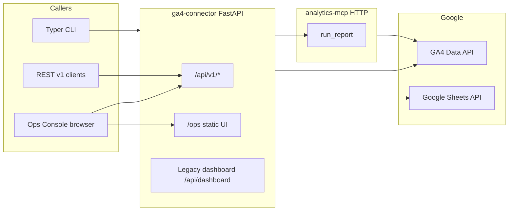

# KartmaX GA4 Connector — overview

This repository connects KartmaX to **Google Analytics 4** for operational reporting: **GMV by source** and **sessions by source** via the official **Google Analytics MCP** (`run_report` over HTTP), **events by name** via the **GA4 Data API** (CLI only today), a **REST v1 API** with **JWT** (and legacy API key on some routes), **Google Sheets export**, and an optional **Ops Console** at `/ops`.

## Architecture

| Path | Technology | Reports |
|------|------------|---------|
| GMV / Sessions (API, CLI reports, Sheets) | MCP HTTP + service-account Bearer to MCP | `gmv_by_source`, `sessions_by_source` |
| Events by name | Direct GA4 Data API (service account) | `events_by_name` — **CLI only** (no `/api/v1` route) |
| Health | MCP connectivity probe | `GET /api/v1/health` |

Inside **Docker Compose**, the connector uses `MCP_SERVER_URL=http://analytics-mcp:8080/mcp`. On the host, point `MCP_SERVER_URL` at your local MCP process (see [mcp-http-setup.md](mcp-http-setup.md)).

## What ships in this repo

### REST API (`/api/v1`)

| Method | Path | Auth | Purpose |
|--------|------|------|---------|
| `POST` | `/api/v1/auth/token` | Client credentials (form) | Issue JWT |
| `GET` | `/api/v1/health` | Bearer JWT or `X-API-Key` | Connector + MCP status |
| `GET` | `/api/v1/reports/gmv-by-source` | Bearer JWT or `X-API-Key` | GMV by session source |
| `GET` | `/api/v1/reports/sessions-by-source` | Bearer JWT or `X-API-Key` | Sessions by session source |
| `POST` | `/api/v1/exports/google-sheets` | **Bearer JWT only** | Upsert GMV and/or Sessions tabs |

JWT tokens carry **scopes** and a **property allowlist** per OAuth client. Sheets export requires scopes matching the requested report types.

### Ops Console (`/ops`)

Enabled with `ENABLE_OPS_CONSOLE=true`. Static HTML/CSS/JS served by FastAPI; **no** secrets or tokens in `localStorage`. You obtain a JWT in the UI and call the same v1 endpoints.

Sections: Overview (health), Authentication, Report Explorer (date-grouped GMV/Sessions tables), API Explorer, Google Sheets export.

### Legacy dashboard (dev only)

When `ENABLE_DASHBOARD=true`, unauthenticated routes include `/`, `/api/dashboard`, `/api/events`, and saved JSON under `output/`. **Production:** keep `ENABLE_DASHBOARD=false` and use `/ops` or API-only.

### CLI (`py -m src.main`)

| Command | Role |
|---------|------|
| `status` | GA4 Data API connectivity |
| `mcp-status` | MCP HTTP connectivity |
| `mcp-run-report-smoke` | MCP `run_report` smoke (sessions, yesterday) |
| `report gmv-by-source` | MCP report → JSON in `output/` |
| `report sessions-by-source` | MCP report → JSON in `output/` |
| `report events-by-name` | Direct GA4 → JSON in `output/` |
| `serve` | Local uvicorn (respects `ENABLE_*` from `.env`) |

### Docker

- `Dockerfile` — connector image  
- `docker/Dockerfile.mcp` — pinned `analytics-mcp==1.1.0` (HTTP)  
- `docker-compose.yml` — connector + MCP  
- `docker-compose.dev.yml` — enables legacy dashboard + Ops Console for local dev  

Secrets are mounted from the host (`.env`, service account path); they are **not** baked into images.

### Tests

- `py -m pytest -q` — standard suite (73+ tests; optional live tests skipped by default)  
- Optional: `RUN_GA4_LIVE_TESTS=1`, `RUN_SHEETS_LIVE_TESTS=1` + `GOOGLE_SHEETS_TEST_SPREADSHEET_ID` (see [production.md](production.md))

## Runtime profiles

| Profile | `ENABLE_DASHBOARD` | `ENABLE_OPS_CONSOLE` | Exposed UI |
|---------|--------------------|-----------------------|------------|
| Production (recommended) | `false` | `true` | `/ops` + API |
| API-only | `false` | `false` | API only |
| Local dev overlay | `true` | `true` | `/`, `/ops`, API |

## Further reading

- [setup-and-run.md](setup-and-run.md) — Windows commands, env, Docker, Ops Console URL  
- [production.md](production.md) — deployment, JWT, Sheets, smoke curls  
- [mcp-http-setup.md](mcp-http-setup.md) — MCP server on host  
- [step-3-implementation.md](step-3-implementation.md) — source report design notes  